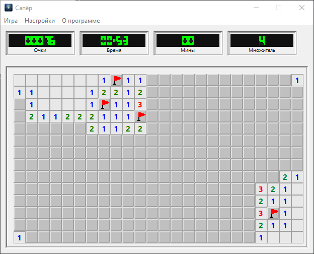
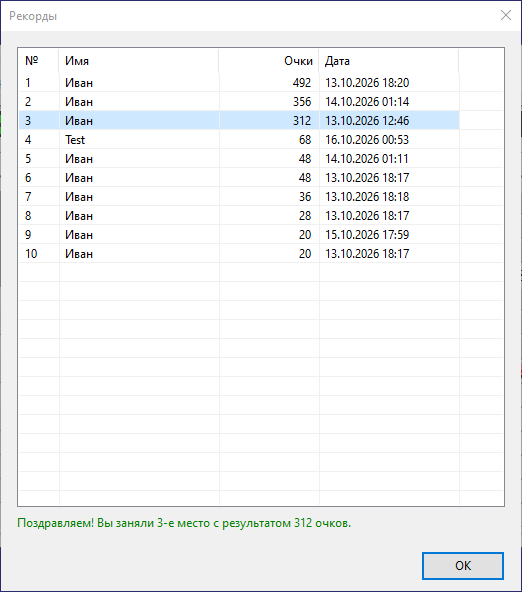

# Сапёр с очками (minesweeper)

[](https://www.embarcadero.com/products/delphi)
[](LICENSE)
[]()

> Классический «Сапёр» переосмысленный: вместо проигрыша при клике на мину —
> система очков, таймер штрафа и множители за сложность.



## 🎯 Особенности

- **4 уровня сложности** — от «Новичка» (12×7) до «Безумца» (24×14).
- **Система очков** — за открытие цифр (`MinesAround × множитель`) и за обезвреженные мины.
- **Таймер штрафа** — каждые N секунд списывает M очков (зависит от сложности).
- **Множители x1..x4** — сложнее игра, больше награда.
- **Chord** — одновременное нажатие левой и правой кнопок открывает соседей открытой цифры.
- **7-сегментные LCD-индикаторы** — нарисованы кодом, без картинок.
- **Топ-30 рекордов** — с XOR + CRC32 защитой от подправки.
- **Адаптивная раскладка** — 1 или 2 ряда индикаторов в зависимости от ширины поля.
- **Один экземпляр игры** — мьютекс + активация окна.

## 🖼 Скриншоты

| Игровое поле | Таблица рекордов |
|---|---|
|  |  |

## 🚀 Сборка и запуск

### Требования

- **Delphi 12 Athens** (или Delphi 10.4+).
- **Windows** (VCL-приложение, WinAPI для `GetModuleFileName` и `GetKeyState`).

### Сборка

1. Клонируйте репозиторий:
   ```bash
   git clone https://github.com/<ваш-ник>/delphi-minesweeper.git
   ```
2. Откройте `minesweeper.dproj` в Delphi.
3. **Project → Build** (Shift+F9).
4. Скомпилированный `.exe` появится в `compiled/`.

### Настройки проекта

Убедитесь, что в **Project → Options**:

| Параметр | Значение |
|---|---|
| **Delphi Compiler → Output directory** | `compiled` |
| **Delphi Compiler → Unit output directory** | `compiled\dcu` |
| **Delphi Compiler → Search Path** | `source;source\models` |
| **Packages → Runtime Packages → Link with runtime packages** | `False` |
| **Application → Manifest → Enable runtime themes** | `True` |

## 🎮 Как играть

### Правила

- **Левый клик** — открыть клетку.
- **Правый клик** — поставить/снять флажок.
- **Одновременное нажатие левой + правой** на открытой клетке с цифрой — **chord**:
  если вокруг стоят ровно столько флажков, сколько мин — открываются все закрытые соседи.
- **Первый левый клик** — стартует партию и запускает таймер.

### Очки

- **Цифра** — `MinesAround × множитель`.
- **Обезвреженная мина** — `MAX(открытые соседи-цифры) × множитель`.
  Награда начисляется, только когда **все** соседи мины открыты или помечены.
- **Таймер** — каждые N секунд списывает M очков. Очки не уходят в минус.

### Победа

Все безопасные клетки открыты, все мины помечены и обезврежены.

### Проигрыш

Попали на мину. **Очки сохраняются** и могут попасть в топ-30.

## 🏗 Архитектура

```
┌─────────────────────────────────────────────────────┐
│                     MainForm                        │  UI
│  ┌──────────────┐ ┌──────────────┐                  │
│  │  SettingsForm│ │  RecordsForm │                  │
│  └──────────────┘ └──────────────┘                  │
└──────────────────────┬──────────────────────────────┘
                       │
        ┌──────────────┼──────────────┐
        ▼              ▼              ▼
   ┌─────────┐  ┌─────────────┐  ┌──────────────┐
   │GameLogic│  │DigitRenderer│  │FieldRenderer │
   └────┬────┘  └─────────────┘  └──────────────┘
        │
        ▼
   ┌──────────────┐  ┌──────────────┐  ┌──────────┐
   │RecordsManager│  │   Settings   │  │FileUtils │
   └──────────────┘  └──────────────┘  └──────────┘
```

### Принципы

- **Логика не зависит от UI** — `GameLogic` можно тестировать отдельно.
- **Точечная перерисовка** — обновляются только изменившиеся клетки.
- **Модульность** — `FileUtils`, `Settings`, `RecordsManager` переиспользуемы в других играх.
- **Нет внешних ресурсов** — всё рисуется кодом, `.exe` самодостаточен.

## 📁 Структура проекта

```
minesweeper/
├── source/                    # Исходники
│   ├── MainForm.pas/.dfm      # Главная форма
│   ├── SettingsForm.pas/.dfm  # Выбор сложности
│   ├── RecordsForm.pas/.dfm   # Таблица рекордов
│   ├── AboutForm.pas/.dfm     # О программе
│   └── models/                # Логика без UI
│       ├── FileUtils.pas
│       ├── Settings.pas
│       ├── RecordsManager.pas
│       ├── GameLogic.pas
│       ├── DigitRenderer.pas
│       └── FieldRenderer.pas
├── compiled/                  # Скомпилированный .exe (в .gitignore)
├── docs/                      # Скриншоты и документация
├── .gitignore
├── LICENSE
└── README.md
```

## 🎨 Технические детали

### 7-сегментные цифры

Рисуются **вручную** через `TCanvas.Polygon`. Нет зависимости от шрифтов.

### Защита рекордов

Файл `records.dat`:
- **JSON** с записями топ-30.
- **XOR** с ключом (защита от подправки блокнотом).
- **CRC32** от JSON (проверка целостности).
- **Блокировка файла** на время работы (нельзя подправить «на лету»).

### Хранение данных

Все runtime-файлы — **рядом** с `.exe`:
- `minesweeper.ini` — настройки.
- `records.dat` — рекорды.

Игра **портативная**: скопировал папку — всё работает.

## 📋 Лицензия

[MIT](LICENSE) — используйте свободно, в том числе в коммерческих целях.

## 🙏 Благодарности

- **Broderbund** — за оригинальный «Сапёр».
- **Embarcadero** — за Delphi и Object Pascal.

## 📬 Обратная связь

- **Issues**: [GitHub Issues](https://github.com/delikates-nsk/delphi-minesweeper/issues)
- **Pull Requests**: приветствуются.

---

**Сделано на Delphi 12 Athens.** Докажем, что Object Pascal жив!
